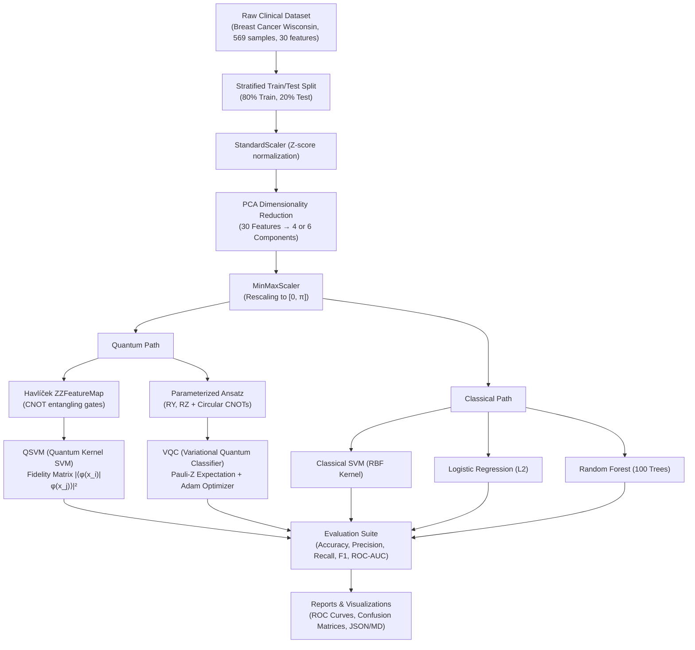

# Quantum Machine Learning for Disease Classification

[](https://www.python.org/)
[](https://qiskit.org/)
[](https://pennylane.ai/)
[](https://scikit-learn.org/)
[](LICENSE)

A hybrid quantum-classical machine learning project that classifies patients (malignant vs. benign) using the public **Breast Cancer Wisconsin (Diagnostic)** dataset. This pipeline explores how quantum feature maps and parameterized quantum circuits integrate into a real-world machine learning pipeline and provides a rigorous, fair benchmark against classical baselines.

---

## 1. The Medical & Scientific Challenge

Medical diagnostics often involve multidimensional tabular datasets where non-linear interactions between morphological features distinguish diseased from healthy tissue. In near-term quantum computing (NISQ era), quantum machine learning explores whether encoding classical data into exponentially large Hilbert spaces allows separating data points that are difficult to separate classically.

> **Objective:** Explore how quantum feature encoding and parameterized ansatz circuits can be incorporated into an end-to-end classification pipeline, evaluated against classical baselines using standardized clinical metrics (Accuracy, ROC-AUC, Sensitivity/Recall, Precision, and F1-score).

---

## 2. Theoretical Foundations

### 2.1 Dimensionality Reduction & Angle Normalization
The Breast Cancer Wisconsin dataset contains 30 continuous morphological features (e.g., radius, texture, perimeter, concavity). Simulating 30 qubits directly would require storing a statevector with $2^{30} \approx 10^9$ complex amplitudes (~16 GB RAM per state).

To maintain computational tractability while preserving high explained variance:
1. **Standardization:** Zero-mean, unit-variance scaling: $z = \frac{x - \mu}{\sigma}$.
2. **Principal Component Analysis (PCA):** Orthogonal projection onto the top $n$ principal axes (default: $n=4$ or $n=6$ qubits), capturing the majority of total data variance.
3. **Angular Range Mapping:** Min-max scaling onto the interval $[0, \pi]$:
   $$\tilde{x}_i = \pi \cdot \frac{x_i - \min(x_i)}{\max(x_i) - \min(x_i)}$$
   This prevents angle periodicity aliasing in trigonometric quantum rotation gates.

### 2.2 Quantum Feature Mapping: Second-Order Pauli-Z Expansion (ZZFeatureMap)
Following Havlíček et al. (*Nature* 567, 209–212, 2019), the classical feature vector $\mathbf{x} \in [0, \pi]^n$ is mapped into a quantum state $|\phi(\mathbf{x})\rangle$:

$$|\phi(\mathbf{x})\rangle = \mathcal{U}_{\Phi(\mathbf{x})} |0\rangle^{\otimes n} = \left[ U_{\Phi(\mathbf{x})} H^{\otimes n} \right]^d |0\rangle^{\otimes n}$$

where the unitary operator encodes both single-qubit phases and pairwise entangling interactions:

$$U_{\Phi(\mathbf{x})} = \exp\left( i \sum_{i=1}^n x_i Z_i + i \sum_{i=1}^n \sum_{j > i}^n (\pi - x_i)(\pi - x_j) Z_i Z_j \right)$$

In quantum circuit terms, the two-qubit term $(\pi - x_i)(\pi - x_j) Z_i Z_j$ is synthesized using a CNOT gate, a parameter-controlled $R_Z$ rotation, and a terminating CNOT gate.

```
       ┌───┐ ┌──────────────┐
q_0: ──┤ H ├─┤ Rz(2*x[0])   ├──■────────────────────────■──
       ├───┤ ├──────────────┤┌─┴─┐┌──────────────────┐┌─┴─┐
q_1: ──┤ H ├─┤ Rz(2*x[1])   ├┤ X ├┤ Rz(2*(π-x0)(π-x1))├┤ X ├──
       └───┘ └──────────────┘└───┘└──────────────────┘└───┘
```

### 2.3 Quantum Support Vector Machine (QSVM / Quantum Kernel)
Instead of computing the inner product in classical feature space, the quantum kernel calculates the transition fidelity in $2^n$-dimensional Hilbert space:

$$K(\mathbf{x}_i, \mathbf{x}_j) = |\langle \phi(\mathbf{x}_i) | \phi(\mathbf{x}_j) \rangle|^2$$

- **Vectorized Optimization:** Rather than running $O(N^2)$ separate circuit executions, our implementation evaluates the statevectors $|\phi(\mathbf{x})\rangle$ in $O(N)$ passes and performs vectorized Hermitian matrix multiplication:
  $$\mathbf{K} = |\mathbf{\Psi} \cdot \mathbf{\Psi}^\dagger|^2$$
- The resulting Gram matrix $\mathbf{K}$ is guaranteed to be symmetric and positive semi-definite with diagonal $K_{ii} = 1.0$, which is supplied to a Support Vector Classifier with precomputed kernel.

### 2.4 Variational Quantum Classifier (VQC)
A parameterized quantum neural network consisting of:
1. **State Encoding:** Single-qubit $R_Y(x_i)$ angle encoding.
2. **Hardware-Efficient Parameterized Ansatz:** $L$ layers of alternating single-qubit rotations ($R_Y(\theta), R_Z(\phi)$) and circular CNOT entanglement rings.
3. **Readout:** Pauli-Z expectation value on the first qubit: $\langle Z_0 \rangle = \langle 0 | U^\dagger(\mathbf{x}, \mathbf{\theta}) Z_0 U(\mathbf{x}, \mathbf{\theta}) | 0 \rangle \in [-1, 1]$.
4. **Logit Mapping:** $P(y=1) = \sigma(2\langle Z_0 \rangle + b) = \frac{1}{1 + e^{-(2\langle Z_0 \rangle + b)}}$.
5. **Optimization:** Trained end-to-end via the Adam optimizer minimizing binary cross-entropy loss with analytical parameter-shift gradients.

---

## 3. Architecture & Pipeline Flow



---

## 4. Project Directory Structure

```
d:\quantum-hackday -sample\
├── main.py                     # Unified CLI pipeline runner & benchmark orchestrator
├── requirements.txt            # Project dependencies
├── README.md                   # Complete scientific and architectural documentation
├── docs/
│   └── superpowers/plans/      # Implementation plan and specification
├── reports/                    # Generated benchmark summaries, ROC curves, confusion matrices
│   ├── benchmark_summary.md
│   ├── benchmark_summary.json
│   ├── roc_comparison.png
│   ├── confusion_matrices.png
│   └── quantum_circuit_zz.txt
├── src/
│   ├── data/
│   │   ├── __init__.py
│   │   └── preprocessor.py     # Stratified split, PCA, [0, pi] scaling
│   ├── quantum/
│   │   ├── __init__.py
│   │   └── feature_maps.py     # ZZFeatureMap, Angle encoding, fidelity overlap
│   ├── models/
│   │   ├── __init__.py
│   │   ├── qsvm.py             # Quantum Kernel Classifier with Platt calibration
│   │   ├── vqc.py              # Variational Quantum Classifier with Adam optimization
│   │   └── classical.py        # Classical SVM, Logistic Regression, Random Forest
│   └── evaluation/
│       ├── __init__.py
│       ├── metrics.py          # Clinical metrics (Accuracy, F1, ROC-AUC, Precision, Recall)
│       └── benchmark.py        # Comparative benchmark runner & figure plotter
└── tests/
    ├── test_preprocessor.py    # Unit tests for data loading & scaling
    ├── test_feature_maps.py    # Unit tests for quantum feature mapping & statevectors
    ├── test_qsvm.py            # Unit tests for quantum kernel matrix & SVM
    ├── test_vqc.py             # Unit tests for VQC forward pass & optimization
    ├── test_benchmark.py       # Unit tests for evaluation suite & baselines
    └── test_pipeline_e2e.py    # End-to-end integration test
```

---

## 5. Getting Started

### 5.1 Environment Setup
Ensure Python 3.10+ is installed (tested on Python 3.13):

```bash
# Clone the repository and enter directory
cd "d:\quantum-hackday -sample"

# Activate your virtual environment (e.g., qiskit-env)
.\qiskit-env\Scripts\activate

# Install dependencies
pip install -r requirements.txt
```

### 5.2 Running the Full Benchmark Pipeline
Execute the end-to-end pipeline comparing all 5 models:

```bash
python main.py --n-qubits 4 --epochs 15
```

CLI options:
- `--n-qubits <int>`: Number of qubits / PCA reduced features (default: `4`).
- `--epochs <int>`: Number of training epochs for the VQC (default: `15`).
- `--report-dir <path>`: Folder where reports and figures will be saved (default: `reports`).
- `--fast-mode`: Runs a quick validation pass on a stratified subset.
- `--random-state <int>`: Deterministic random seed (default: `42`).

### 5.3 Running the Test Suite
All tests are implemented using `pytest` and follow strict Test-Driven Development (TDD):

```bash
python -m pytest tests/ -v
```

---

## 6. Output Artifacts

Upon running `main.py`, the following artifacts are generated in the `reports/` directory:
- **`benchmark_summary.md`**: Markdown table comparing Accuracy, Precision, Recall, F1, ROC-AUC, Training Time, and Inference Time across all 5 models.
- **`benchmark_summary.json`**: Machine-readable JSON dictionary containing all raw evaluation metrics and confusion matrices.
- **`roc_comparison.png`**: High-resolution visualization plotting ROC curves for all models side-by-side with AUC values.
- **`confusion_matrices.png`**: Visual comparison grid of confusion matrices annotated with True vs. Predicted diagnoses.
- **`quantum_circuit_zz.txt`**: ASCII circuit schematic showing the exact quantum gate decomposition of the ZZFeatureMap.

---

## 7. Ethical and Privacy Standards

- **De-identified Data:** This project uses the open-access **Breast Cancer Wisconsin (Diagnostic)** dataset collected by Dr. William H. Wolberg, W. Nick Street, and Olvi L. Mangasarian (University of Wisconsin).
- **Zero Personally Identifiable Information (PII):** The dataset consists solely of anonymized numeric cell nuclear morphology measurements. No patient names, dates of birth, medical record numbers, or locations are included or processed.
